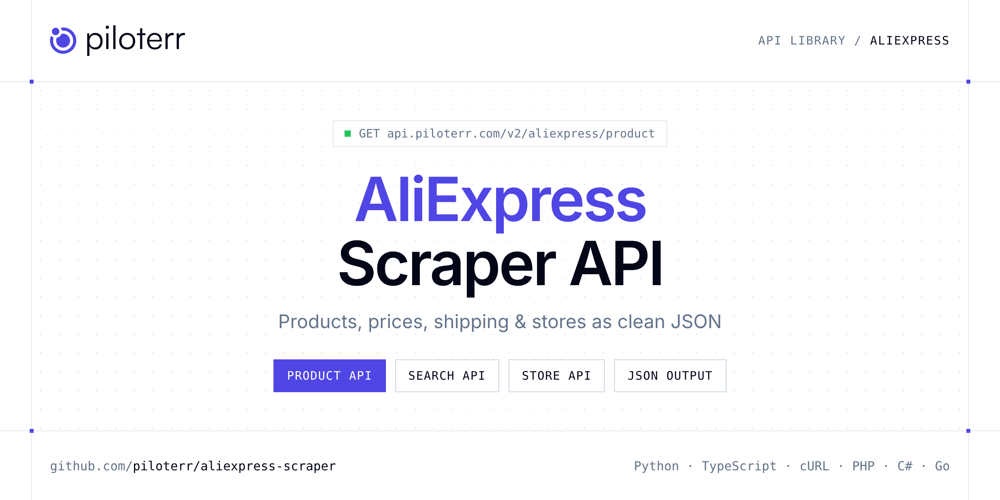

<p align="center">
  <a href="https://www.piloterr.com"></a>
</p>

# AliExpress Scraper API

[](https://discord.gg/CFj3ph8aHU) [](https://app.piloterr.com) [](https://app.piloterr.com/openapi) [](LICENSE)

The **Piloterr AliExpress Scraper API** lets you extract public data from [AliExpress](https://www.aliexpress.com) — product details, prices and discounts, shipping cost and estimated delivery, specifications, buyer FAQs, seller information, store catalogs and keyword search results — as **clean, structured JSON**. Pages are rendered in a real browser on Piloterr's side, so you never deal with proxies, CAPTCHAs or JavaScript-heavy HTML.

Use it for dropshipping product research, price and discount tracking, competitor store monitoring, catalog imports or e-commerce analytics on top of AliExpress.

| Endpoint | Path | Credits | What you get |
|---|---|---|---|
| [AliExpress Product API](#aliexpress-product-api) | `/v2/aliexpress/product` | 2 | Scrape a single AliExpress `/item/` page from its URL |
| [AliExpress Search API](#aliexpress-search-api) | `/v2/aliexpress/search` | 2 | Scrape AliExpress search results from a keyword or a wholesale URL |
| [AliExpress Store Product API](#aliexpress-store-product-api) | `/v2/aliexpress/store/product` | 2 | List the products of an AliExpress seller store from a store URL or numeric store ID |

## Table of contents

- [How it works](#how-it-works)
- [AliExpress Product API](#aliexpress-product-api)
- [AliExpress Search API](#aliexpress-search-api)
- [AliExpress Store Product API](#aliexpress-store-product-api)
- [Code examples in other languages](#code-examples-in-other-languages)
- [Practical use cases](#practical-use-cases)
- [Why Piloterr?](#why-piloterr)
- [FAQ](#faq)
- [Related scrapers](#related-scrapers)
- [Support](#support)

## How it works

1. **Create a free Piloterr account** and copy your API key from the [dashboard](https://app.piloterr.com).
2. **Send a `GET` (or `POST`) request** to `https://api.piloterr.com/v2/...` with the header `x-api-key: YOUR_API_KEY`.
3. **Receive structured JSON** — Piloterr handles rendering, proxies, retries and parsing.

```bash
export PILOTERR_API_KEY="your-api-key"
pip install requests        # Python
# TypeScript: Node.js 18+ (native fetch), run with `npx tsx file.ts`
```

> Every endpoint accepts both `GET` (query string) and `POST` (JSON body with the same fields).

## AliExpress Product API

Scrape a single AliExpress `/item/` page from its URL: name, media, rating, reviews, sold and available counts, seller, price, original price, discount, delivery info, specifications and FAQs.

`GET | POST https://api.piloterr.com/v2/aliexpress/product` · **2 credits per request** · [Full reference](https://www.piloterr.com/library/aliexpress-product)

### Request parameters

| Parameter | Type | Required | Description |
|---|---|---|---|
| `query` | string | ✅ | Full AliExpress product URL, e.g. `https://www.aliexpress.com/item/1005009517624640.html`. |
| `return_page_source` | boolean | — | Return the raw HTML as `{"result": "..."}`. Default `false`. |

### Python example

```python
import os
import requests

response = requests.get(
    "https://api.piloterr.com/v2/aliexpress/product",
    headers={"x-api-key": os.environ["PILOTERR_API_KEY"]},
    params={
        "query": "https://www.aliexpress.com/item/1005009517624640.html",
    },
    timeout=60,
)
response.raise_for_status()
data = response.json()

print(data["info"]["name"])
print(data["pricing"]["price"], data["pricing"]["price_currency"], "-", data["pricing"]["discount"])
```

### TypeScript example

```typescript
interface AliExpressProduct {
  info: {
    product_id: number;
    name: string;
    link: string;
    media: string[];
    rate: number | null;
    reviews: number | null;
    sold_count: number;
    available_count: number;
    seller_name: string | null;
    seller_id: string | null;
  };
  pricing: {
    price: number;
    price_currency: string | null;
    original_price: number | string;
    discount: string;
  };
  delivery: {
    pickup_method: string;
    shipping_cost: number;
    shipping_cost_currency: string;
    estimated_delivery: string;
  } | null;
  specifications: { name: string; value: string }[];
  faqs: { question: string; answer: string }[];
}

const params = new URLSearchParams({
  "query": "https://www.aliexpress.com/item/1005009517624640.html",
});

const response = await fetch(`https://api.piloterr.com/v2/aliexpress/product?${params}`, {
  headers: { "x-api-key": process.env.PILOTERR_API_KEY! },
});
if (!response.ok) throw new Error(`Piloterr error ${response.status}: ${await response.text()}`);

const data = (await response.json()) as AliExpressProduct;

console.log(data.info.name);
console.log(data.pricing.price, data.pricing.price_currency, '-', data.pricing.discount);
```

<details>
<summary><b>POST variant</b></summary>

```http
POST https://api.piloterr.com/v2/aliexpress/product
x-api-key: YOUR_API_KEY
Content-Type: application/json

{"query": "https://www.aliexpress.com/item/1005009517624640.html"}
```
</details>

### Output example

Example response from the API reference, abridged — real values depend on the page you scrape.

```json
{
  "info": {
    "product_id": 1005009517624640,
    "name": "Example Wireless Earbuds Bluetooth 5.3",
    "link": "https://www.aliexpress.com/item/1005009517624640.html",
    "media": [
      "https://ae01.alicdn.com/kf/....jpg"
    ],
    "rate": 4.7,
    "reviews": 1834,
    "sold_count": 5000,
    "available_count": 999,
    "seller_name": "Example Official Store",
    "seller_id": "1101705614"
  },
  "pricing": {
    "price": 12.99,
    "price_currency": "USD",
    "original_price": 25.98,
    "discount": "50%"
  },
  "delivery": {
    "pickup_method": "Standard Shipping",
    "shipping_cost": 0,
    "shipping_cost_currency": "USD",
    "estimated_delivery": "Nov 12 - 18"
  },
  "specifications": [
    {
      "name": "Brand Name",
      "value": "Example"
    }
  ],
  "faqs": [
    {
      "question": "Does it work with iPhone?",
      "answer": "Yes."
    }
  ]
}
```

### Response fields

| Field | Type | Description |
|---|---|---|
| `info` | object | `product_id`, `name`, `link`, `media[]`, `rate`, `reviews`, `sold_count`, `available_count`, `seller_name`, `seller_id` |
| `pricing` | object | `price`, `price_currency`, `original_price`, `discount` |
| `delivery` | object | null | `pickup_method`, `shipping_cost`, `shipping_cost_currency`, `estimated_delivery` |
| `specifications[]` | object[] | Product specs as `name` / `value` pairs |
| `faqs[]` | object[] | Buyer questions as `question` / `answer` pairs |

## AliExpress Search API

Scrape AliExpress search results from a keyword or a wholesale URL: listings with title, price, currency, rating, sold count, seller and brand, plus pagination metadata.

`GET | POST https://api.piloterr.com/v2/aliexpress/search` · **2 credits per request** · [Full reference](https://www.piloterr.com/library/aliexpress-search)

### Request parameters

| Parameter | Type | Required | Description |
|---|---|---|---|
| `query` | string | ✅ | Search keyword (e.g. `meta`) or a full AliExpress search URL. To paginate, pass a URL containing `?page=N`. |
| `return_page_source` | boolean | — | Return the raw HTML as `{"result": "..."}`. Default `false`. |

### Python example

```python
import os
import requests

response = requests.get(
    "https://api.piloterr.com/v2/aliexpress/search",
    headers={"x-api-key": os.environ["PILOTERR_API_KEY"]},
    params={
        "query": "meta",
    },
    timeout=60,
)
response.raise_for_status()
data = response.json()

for item in data["results"]:
    print(item["title"], "|", item["price"], item["currency"], "|", item.get("sold_count"))
print("Next page:", data["next"])
```

### TypeScript example

```typescript
interface AliExpressSearch {
  results: {
    product_id: string;
    title: string;
    listing_url: string;
    image_url: string;
    price: number;
    currency: string;
    condition: string;
    rating?: number;
    sold_count?: number;
    seller_name?: string;
    seller_id?: string;
    brand?: string;
    review_count?: number;
  }[];
  page: number;
  per_page: number;
  total_results: number;
  total_pages: number;
  next: boolean;
}

const params = new URLSearchParams({
  "query": "meta",
});

const response = await fetch(`https://api.piloterr.com/v2/aliexpress/search?${params}`, {
  headers: { "x-api-key": process.env.PILOTERR_API_KEY! },
});
if (!response.ok) throw new Error(`Piloterr error ${response.status}: ${await response.text()}`);

const data = (await response.json()) as AliExpressSearch;

for (const item of data.results) {
  console.log(item.title, '|', item.price, item.currency, '|', item.sold_count);
}
console.log('Next page:', data.next);
```

**More request examples**

```http
GET https://api.piloterr.com/v2/aliexpress/search?query=https://www.aliexpress.com/w/wholesale-meta.html
GET https://api.piloterr.com/v2/aliexpress/search?query=https://www.aliexpress.com/w/wholesale-meta.html?page=2
```

<details>
<summary><b>POST variant</b></summary>

```http
POST https://api.piloterr.com/v2/aliexpress/search
x-api-key: YOUR_API_KEY
Content-Type: application/json

{"query": "meta"}
```
</details>

### Output example

Example response from the API reference, abridged — real values depend on the page you scrape.

```json
{
  "results": [
    {
      "product_id": "1005009517624640",
      "title": "Example Smart Glasses Bluetooth",
      "listing_url": "https://www.aliexpress.com/item/1005009517624640.html",
      "image_url": "https://ae01.alicdn.com/kf/....jpg",
      "price": 29.99,
      "currency": "USD",
      "condition": "new",
      "rating": 4.6,
      "sold_count": 1000,
      "seller_name": "Example Store",
      "seller_id": "1101705614"
    }
  ],
  "page": 1,
  "per_page": 60,
  "total_results": 6000,
  "total_pages": 100,
  "next": true
}
```

### Response fields

| Field | Type | Description |
|---|---|---|
| `results[].product_id` | string | AliExpress product ID |
| `results[].title` | string | Product title |
| `results[].listing_url / image_url` | string | Canonical `/item/{id}.html` URL and thumbnail |
| `results[].price / currency` | number / string | Price and ISO 4217 currency |
| `results[].rating / review_count / sold_count` | number | Social proof, when shown |
| `results[].seller_name / seller_id / brand` | string | Seller and brand, when shown |
| `page / per_page / total_results / total_pages / next` | pagination | Pagination metadata (about 60 results per page) |

## AliExpress Store Product API

List the products of an AliExpress seller store from a store URL or numeric store ID: store metadata plus about 40 product cards, with optional sorting.

`GET | POST https://api.piloterr.com/v2/aliexpress/store/product` · **2 credits per request** · [Full reference](https://www.piloterr.com/library/aliexpress-store-product)

### Request parameters

| Parameter | Type | Required | Description |
|---|---|---|---|
| `query` | string | ✅ | Store URL containing `/store/{id}` or a numeric store ID (e.g. `1101705614`). |
| `sort` | string | — | Sort alias: `default`, `bestmatch`, `orders`, `new` or `price`. |
| `return_page_source` | boolean | — | Return the raw HTML as `{"result": "..."}`. Default `false`. |

### Python example

```python
import os
import requests

response = requests.get(
    "https://api.piloterr.com/v2/aliexpress/store/product",
    headers={"x-api-key": os.environ["PILOTERR_API_KEY"]},
    params={
        "query": "1101705614",
        "sort": "orders",
    },
    timeout=60,
)
response.raise_for_status()
data = response.json()

print(data["store_name"], "-", len(data["results"]), "products")
for item in data["results"]:
    print(item["title"], "|", item.get("price"), item.get("currency"))
```

### TypeScript example

```typescript
interface AliExpressStore {
  store_id: string;
  seller_id: string;
  owner_member_id?: string;
  store_name: string;
  results: {
    product_id: string;
    title: string;
    listing_url: string;
    image_url?: string;
    price?: number;
    currency?: string;
    rating?: number;
    sold_count?: number;
    review_count?: number;
  }[];
}

const params = new URLSearchParams({
  "query": "1101705614",
  "sort": "orders",
});

const response = await fetch(`https://api.piloterr.com/v2/aliexpress/store/product?${params}`, {
  headers: { "x-api-key": process.env.PILOTERR_API_KEY! },
});
if (!response.ok) throw new Error(`Piloterr error ${response.status}: ${await response.text()}`);

const data = (await response.json()) as AliExpressStore;

console.log(data.store_name, '-', data.results.length, 'products');
for (const item of data.results) {
  console.log(item.title, '|', item.price, item.currency);
}
```

**More request examples**

```http
GET https://api.piloterr.com/v2/aliexpress/store/product?query=https://www.aliexpress.com/store/1101705614
```

<details>
<summary><b>POST variant</b></summary>

```http
POST https://api.piloterr.com/v2/aliexpress/store/product
x-api-key: YOUR_API_KEY
Content-Type: application/json

{"query": "1101705614", "sort": "orders"}
```
</details>

### Output example

Example response from the API reference, abridged — real values depend on the page you scrape.

```json
{
  "store_id": "1101705614",
  "seller_id": "2200000000000",
  "owner_member_id": "220000000",
  "store_name": "Example Official Store",
  "results": [
    {
      "product_id": "1005009517624640",
      "title": "Example Wireless Earbuds Bluetooth 5.3",
      "listing_url": "https://www.aliexpress.com/item/1005009517624640.html",
      "image_url": "https://ae01.alicdn.com/kf/....jpg",
      "price": 12.99,
      "currency": "USD",
      "rating": 4.7,
      "sold_count": 5000
    }
  ]
}
```

### Response fields

| Field | Type | Description |
|---|---|---|
| `store_id / seller_id / owner_member_id` | string | Public store ID, internal seller ID and member ID |
| `store_name` | string | Store display name |
| `results[].product_id / title / listing_url` | string | Product identity; pass `listing_url` to the Product API for full details |
| `results[].image_url / price / currency` | string / number | Thumbnail, sale price and ISO 4217 currency |
| `results[].rating / sold_count / review_count` | number | Social proof, when shown |

## Code examples in other languages

Ready-to-run examples live in the [`examples/`](examples) folder. Each one reads your key from the `PILOTERR_API_KEY` environment variable.

| Language | Product | Search | Store Product |
|---|---|---|---|
| cURL (Bash) | [`product`](examples/curl/product.sh) | [`search`](examples/curl/search.sh) | [`store-product`](examples/curl/store_product.sh) |
| PHP | [`product`](examples/php/product.php) | [`search`](examples/php/search.php) | [`store-product`](examples/php/store_product.php) |
| C# | [`product`](examples/csharp/Product.cs) | [`search`](examples/csharp/Search.cs) | [`store-product`](examples/csharp/StoreProduct.cs) |
| Go | [`product`](examples/go/product.go) | [`search`](examples/go/search.go) | [`store-product`](examples/go/store_product.go) |
| Java | [`product`](examples/java/ProductExample.java) | [`search`](examples/java/SearchExample.java) | [`store-product`](examples/java/StoreProductExample.java) |
| Ruby | [`product`](examples/ruby/product.rb) | [`search`](examples/ruby/search.rb) | [`store-product`](examples/ruby/store_product.rb) |
| Node.js | [`product`](examples/nodejs/product.mjs) | [`search`](examples/nodejs/search.mjs) | [`store-product`](examples/nodejs/store_product.mjs) |

## Practical use cases

- **Dropshipping product research** — Spot winning products with sold counts, ratings and review volumes from search and store pages.
- **Price & discount tracking** — Monitor `price`, `original_price` and `discount` daily to catch promotions and price drops.
- **Competitor store monitoring** — Follow a seller's catalog sorted by `orders` or `new` to see what sells and what launches.
- **Shipping intelligence** — Compare shipping cost, method and estimated delivery windows across products.
- **Catalog imports** — Pull media, specifications and FAQs to populate your Shopify, WooCommerce or PIM listings.

## Why Piloterr?

- **No infrastructure** — no proxies, headless browsers or CAPTCHA solving to run yourself.
- **Structured JSON** — stable, documented fields instead of brittle HTML selectors.
- **Pay per request** — transparent credit cost per endpoint, failed requests are retried for you.
- **One API key, hundreds of sources** — AliExpress plus many other e-commerce, search and company data endpoints in the [Piloterr library](https://www.piloterr.com/library).
- **Any language** — plain HTTPS + JSON, with examples for Python, TypeScript, cURL, PHP, C#, Go, Java, Ruby and Node.js.

## FAQ

### Is it legal to scrape AliExpress?

Collecting publicly available data is generally allowed in many jurisdictions, but rules depend on your country, the data you collect and how you use it. Avoid personal data, respect the website's terms where they apply, and get legal advice for your specific use case. This is not legal advice.

### Do I need proxies or a headless browser?

No. AliExpress pages are rendered in a real browser on Piloterr's side, with proxy rotation and retries handled for you. You only send an HTTPS request with your `x-api-key` header.

### How much does a request cost?

Each endpoint (Product, Search, Store Product) costs **2 credits** per request because it uses browser rendering. See the [Piloterr website](https://www.piloterr.com) for plans.

### How do I paginate AliExpress search results?

There is no separate `page` parameter: pass a search URL containing `?page=N` (e.g. `https://www.aliexpress.com/w/wholesale-meta.html?page=2`) and keep going while `next` is `true`.

### Can I get every product of an AliExpress store?

The Store Product endpoint returns about 40 product cards per call and does not paginate. Use `sort` (`orders`, `new`, `price`…) to get different slices, then call the Product API on each `listing_url` for full details.

### Can I get the raw HTML instead of JSON?

Yes. Set `return_page_source=true` and the response becomes `{"result": "..."}` with the page source.

### Which languages are supported?

Any language that can make an HTTP request. This README shows Python and TypeScript; the [`examples/`](examples) folder contains cURL, PHP, C#, Go, Java, Ruby and Node.js.

## Related scrapers

- [Alibaba Scraper API](https://github.com/piloterr/alibaba-scraper)
- [All Piloterr scrapers on GitHub](https://github.com/piloterr)

## Support

- 💬 Join the [Piloterr Discord](https://discord.gg/CFj3ph8aHU) to ask questions and share what you build.
- 📚 Browse the [API reference (OpenAPI)](https://app.piloterr.com/openapi) and the [Piloterr library](https://www.piloterr.com/library).
- 🔑 [Get your API key](https://app.piloterr.com).

---

<p align="center">
  <a href="https://www.piloterr.com">
    <picture>
      <source media="(prefers-color-scheme: dark)" srcset="images/logo-dark.svg">
      
    </picture>
  </a>
  <br>
  <sub>Built by <a href="https://www.piloterr.com">Piloterr</a> — web scraping APIs for e-commerce, search, real estate and more, one API key.</sub>
</p>

<sub>AliExpress is a trademark of its respective owner. This repository is not affiliated with or endorsed by AliExpress. Examples are released under the MIT license.</sub>
